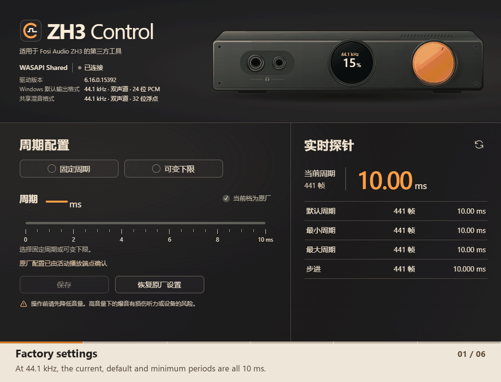
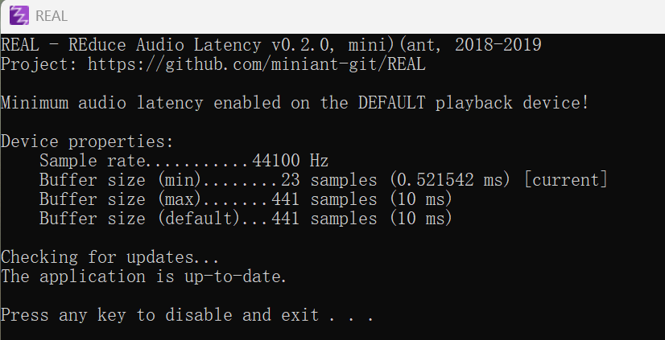

[简体中文](README.md) · **English**

# ZH3 WASAPI shared-mode low-latency tool

**ZH3 Control** is a Windows desktop tool for adjusting the WASAPI shared-mode playback period on the Fosi Audio ZH3. It is written in **Rust**, with an HTML, CSS and JavaScript interface displayed by WebView2. This is an independent third-party project with no affiliation with Fosi Audio or the osu! development team.

I started this project to shorten the time between pressing a key in **osu!lazer** and hearing the hitsound. In shared mode, Windows mixes audio from multiple apps before sending it to the audio device. Its audio engine processes a batch of frames at regular intervals. That interval is the *engine period*. A shorter period can reduce one part of the wait, and other games or audio apps using the same ZH3 shared output may benefit too. Tests confirmed that the engine period changed. The delay from a keypress in osu!lazer to the ZH3’s analog output has yet to be measured.

Find the Windows x64 download under **Releases** on the repository home page. For details on how the driver reports available periods, or how to test another audio device, see the [research and implementation notes](docs/TECHNICAL.en.md).

## Walkthrough

This replay uses the ZH3 Control 1.0.0 interface and readings verified on a physical ZH3. The app’s controls are in Simplified Chinese, and the animation has English captions. It starts at the factory setting of 10 ms at 44.1 kHz. Select **可变下限** (variable minimum), drag the slider to **0.5 ms**, then save and confirm the device restart. Once the ZH3 returns, the probe reads a minimum of **23 frames (about 0.52 ms)**. The default stays at **10 ms**. In this example, the current period changes to 0.52 ms only when a playback client requests 23 frames.

<picture>
  <source media="(prefers-reduced-motion: reduce)" srcset="docs/images/zh3-range-result.png">
  
</picture>

## Requirements and setup

- You need Windows x64, a Fosi Audio ZH3 and the Microsoft Edge WebView2 Runtime. Writing playback settings has been verified with Fosi USB driver **6.16.0.15392** and stereo playback. Connect only one ZH3 while using the tool. [WebView2 Runtime](https://developer.microsoft.com/microsoft-edge/webview2/)
- Download the Windows x64 ZIP from Releases, extract it to a writable folder and run `ZH3-Control.exe`. It requests administrator privileges at startup so it can update the driver’s playback settings and request a device restart. When you change a setting, the app stores its state in the `ZH3-Data` folder next to the EXE. You can take that folder with you if you move the app.
- Check the device and driver version in the window. On the round display, the upper-left corner shows the Windows shared-mode mix sample rate, and the center shows the Windows volume for that playback endpoint. The probe on the right shows the current, default, minimum and maximum periods, along with the step size, in both milliseconds and frames.

## Choosing a period

| What you want | Lowest setting to use | Results at 44.1 kHz |
| --- | --- | --- |
| Keep the 10 ms default and let apps that support shorter periods request one | **可变下限** (variable minimum), **0.5 ms** | The minimum was 23 frames (about 0.52 ms). A client requested 23 frames and the engine ran at that period. The default stayed at 441 frames (10 ms). |
| Use a shorter default period for ordinary shared playback | **固定周期** (fixed period), **5 ms recommended minimum** | Lower settings can fall back to 10 ms. In a driver test that combined a 5 ms default with a 3 ms minimum, the engine offered a single period of 221 frames (about 5.01 ms), and an independent client successfully used it. |

Both modes were also tested in the 1.0.0 release app. With a **3.5 ms variable minimum**, the engine reported 155–441 frames in steps of one frame. When a test client requested 256 frames, the engine ran at about 5.80 ms. With a **fixed period of 8 ms**, the default, minimum, maximum and step were all 353 frames, and the test stream ran at about 8.00 ms.

Turn the volume down and pause playback. Select a mode, adjust the slider and click **保存** (Save). When you confirm, the app writes the setting and requests a restart of the ZH3. Once the device returns, check the probe readings to see whether the change took effect. In variable-minimum mode, a current period of 10 ms is expected if the app playing audio still uses the default. To switch modes, click **恢复原厂设置** (Restore factory settings) and wait for verification to finish before selecting the other mode.

### Measuring a 0.5 ms minimum with REAL

After setting the variable minimum to **0.5 ms**, we checked the Windows default playback device with **REAL v0.2.0**. REAL opens a shared playback stream on that device, requests the minimum period the driver reports and holds the stream open while REAL is running. [REAL project and how it works](https://github.com/miniant-git/REAL)

| REAL reading at 44,100 Hz | Frames | Time |
| --- | ---: | ---: |
| Minimum, marked `[current]` | 23 | **0.521542 ms** |
| Default | 441 | 10 ms |
| Maximum | 441 | 10 ms |



At 44,100 Hz, 0.5 ms works out to 22.05 frames, which rounds up to 23 whole frames. While REAL held the stream open, the shared engine ran at close to 0.5 ms and retained the 10 ms default. The 23 frames describe how much audio the engine processes each cycle. Finding out how much sooner you hear a hitsound through headphones in osu!lazer requires measuring the whole path from keypress to sound. Playback stability at 0.5 ms during long sessions or under heavy load also remains untested.

## Risks and recovery

- Short periods or device restarts can cause silence, dropouts, distortion or pops. A loud pop can damage your hearing, headphones or speakers. Turn down your headphone amplifier or speakers first, and decide whether to proceed based on your own equipment. You use the tool at your own risk.
- The slider accepts 0.5–10 ms in 0.5 ms increments. A fixed period below 5 ms may fall back to 10 ms. Below 3 ms, either mode may fail to take effect or leave you with no sound. If something goes wrong, stop playback and restore factory settings. Shorter periods give the device and apps less time to deliver each batch of audio.
- **恢复原厂设置** (Restore factory settings) applies to all registered playback profiles on this ZH3, including profiles for bit depths you are not currently using. It also resets any periods you previously customized yourself. The app keeps the current bit depth and sample rate throughout recovery. If the Fosi control panel blocks the restart, exit it from the Windows system tray, then follow the prompts to retry or reconnect the ZH3. If you see **待核验** (pending verification), wait for the device to return so the app can read back the settings.

## Building from source

The Windows x64 release of 1.0.0 was built with the stable Rust MSVC toolchain and Visual Studio Community 2026, using the x64/x86 MSVC build tools and Windows 11 SDK. Run these commands in PowerShell from the repository root.

```powershell
.\tools\build-community.ps1 -Mode Build -BuildDir .\target\community
.\tools\build-community.ps1 -Mode Test -BuildDir .\target\community
```

The release executable is written to `target/community/ZH3-Control.exe`. The script verifies the Visual Studio Community linker and records a hash of the build output. You can run the regular tests on a PC without a ZH3 connected. On the first build, Cargo downloads any dependencies in the lockfile that are missing from its cache. With Playwright and Chromium installed, you can also run `node --test app/tests/retry-ui.cjs` to check that each restart confirmation applies to the correct pending operation.

## Credits and licenses

The project is credited to **ZH3 Control Project**. **OpenAI Codex (GPT-6.2 Astra)** implemented most of the code.

The project’s own software code is licensed under **PolyForm Noncommercial 1.0.0**. Under its terms, you may use, modify and distribute the code for noncommercial purposes. When distributing it, include the license text or a link to it, along with the author’s required notice. You may distribute a modified EXE on its own without publishing its source code. The project’s original artwork and documentation are licensed under **CC BY-NC-SA 4.0**. Give credit and indicate any changes when sharing, and distribute adaptations under the same license. Bundled third-party components have their own license terms. [License scope and attribution](LICENSE.en.txt) · [Third-party notices](THIRD-PARTY-NOTICES.txt)

This is my first project on GitHub. If this tool helped you or inspired you, I’d appreciate a star.
