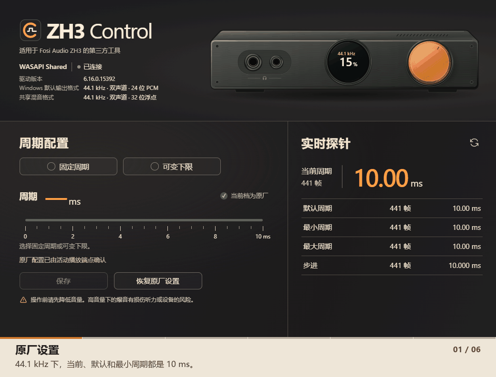
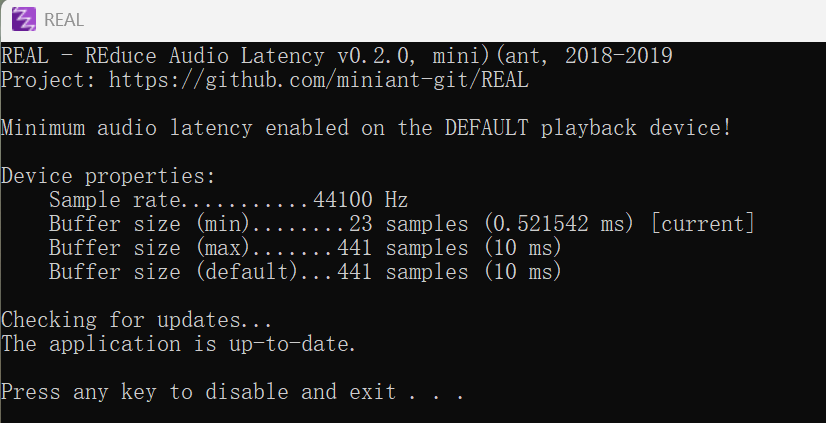

**简体中文** · [English](README.en.md)

# ZH3 WASAPI 共享模式低延迟工具

**ZH3 Control** 是一个用 **Rust** 编写的 Windows 桌面工具，用来调整 Fosi Audio ZH3 在 WASAPI 共享模式下的播放周期。界面使用 HTML、CSS 和 JavaScript，由 WebView2 显示。这是独立开发的第三方工具，与 Fosi Audio 和 osu! 开发团队没有隶属关系。

这个项目起于一个实际需求：在玩 **osu!lazer** 时，尽量缩短从按键到听见打击音的时间。Windows 在共享模式下会把多个应用的声音混合后送往声卡；音频引擎每隔一段时间处理一批音频，这段时间就是这里说的「周期」。缩短周期有机会减少这条播放链路中的一部分等待，其他通过同一 ZH3 共享输出播放的游戏或音频应用也可能受益。项目已经测到了引擎周期的变化，尚未测量 osu!lazer 从按键到模拟音频输出的实际延迟。

Windows x64 下载在本仓库首页的 **Releases**。如果想了解驱动如何公布周期，或在其他声卡上验证，请阅读[研究过程与技术实现](docs/TECHNICAL.md)。

## 操作演示

从原厂 10 ms 开始，选择「可变下限」，将滑条拖到 **0.5 ms**，点「保存」并确认重启。下面用 ZH3 Control 1.0.0 的实际界面回放真机测得的读数。

<picture>
  <source media="(prefers-reduced-motion: reduce)" srcset="docs/images/zh3-range-result.png">
  
</picture>

重启后先看探针里的「最小周期」。在 44.1 kHz 下，23 帧约为 **0.52 ms**。此时「当前周期」仍可显示 10 ms。演示最后，播放应用请求了 23 帧，「当前周期」才随之变为 0.52 ms，「默认周期」一直保持 10 ms。

## 使用条件

- Windows x64、Fosi Audio ZH3、可用的 Microsoft Edge WebView2 Runtime。写入周期配置已验证的环境为 Fosi USB 驱动 **6.16.0.15392**、双声道播放。运行时只连接一台目标 ZH3。[WebView2 Runtime](https://developer.microsoft.com/microsoft-edge/webview2/)
- 从 Releases 下载 Windows x64 的 ZIP，解压到一个可写文件夹，运行 `ZH3-Control.exe`。程序在启动时请求管理员权限，用于修改目标驱动的播放配置并请求重启设备。修改时所需的状态文件保存在 EXE 同级的 `ZH3-Data`，移动程序时可以一并带走。
- 检查窗口里显示的设备和驱动版本。圆屏左上显示 Windows 当前共享混音采样率，中央是该播放端点的 Windows 音量。右侧探针给出当前、默认、最小、最大周期和步进，分别显示毫秒与帧数。

## 怎么选周期

| 你的目标 | 模式与最低值 | 44.1 kHz 下的表现 |
| --- | --- | --- |
| 保留 10 ms 默认值，让支持短周期的应用自行请求 | **可变下限，最低 0.5 ms** | 实测最小 23 帧（约 0.52 ms），客户端请求后可按 23 帧运行，默认仍为 441 帧（10 ms）。 |
| 让普通共享播放直接使用较短的默认周期 | **固定周期，建议最低 5 ms** | 实际使用中，低于 5 ms 可能回退到 10 ms。驱动组合试验中，同时给定 5 ms 默认和 3 ms 下限后，引擎仅提供固定 221 帧（约 5.01 ms），独立客户端成功按 221 帧播放。 |

1.0.0 正式版还实测了两个档位。选择 **3.5 ms 可变下限**时，引擎公布 155–441 帧、步进 1 帧，客户端请求 256 帧后实际运行约 5.80 ms。选择 **8 ms 固定周期**时，默认、最小、最大和步进均为 353 帧，测试流实际运行约 8.00 ms。

先降低音量，暂停播放，再选模式、调滑条并点「保存」。确认后，程序写入设置并请求重启这台 ZH3。设备返回后，以探针读回的数值判断是否生效。使用可变下限时，如果应用仍使用默认周期，探针继续显示 10 ms 是正常的。想换另一种模式，先点「恢复原厂设置」，等核验完成后再选。

### REAL 实测：0.5 ms 下限

将可变下限设为 **0.5 ms** 后，使用 **REAL v0.2.0** 查看 Windows 默认播放设备。REAL 会在默认播放设备上打开一条共享播放流，主动请求驱动公布的最小周期，并在程序运行期间保持这条流。[REAL 项目与工作原理](https://github.com/miniant-git/REAL)

| REAL 在 44,100 Hz 下的显示 | 帧数 | 时间 |
| --- | ---: | ---: |
| 最小，标为 `[current]`（当前） | 23 | **0.521542 ms** |
| 默认 | 441 | 10 ms |
| 最大 | 441 | 10 ms |



44,100 Hz 下的 0.5 ms 相当于 22.05 帧，按整帧向上取整即为 23 帧。这次观测说明，REAL 运行期间，共享引擎用上了接近 0.5 ms 的周期，同时保留了 10 ms 默认值。这个数字只描述音频引擎一次处理多少帧。要知道打 osu!lazer 时从按键到耳机出声快了多少，还需要测量整条链路。此次测试也没有验证 0.5 ms 在长时间游戏或高负载下能否稳定播放。

## 风险与恢复

- 低周期或设备重启可能造成无声、中断、失真或爆音。高音量下的爆音可能伤害听力、耳机或音箱。使用前请先降低耳放或音箱音量，按自己的设备情况决定是否操作，并自行承担相关风险。
- 滑条可提交 0.5–10 ms，每格 0.5 ms。固定周期低于 5 ms 可能回退到 10 ms；任一模式低于 3 ms 都可能无效或无声。若出现异常，请停止播放并恢复原厂。数值越小，设备和应用也越难稳定地按时供给音频。
- 「恢复原厂设置」针对这台 ZH3 的所有已登记播放档，包括当前未使用的位深档。原先自行调整过的播放周期也在恢复范围内。程序不会为了恢复去切换位深或采样率。若 Fosi 控制面板阻止重启，先从系统托盘退出面板，再按界面提示重试或重新连接 ZH3。看到「待核验」时仍需等设备返回并读回。

## 从源码构建

1.0.0 的 Windows x64 发行版使用 Rust 稳定版 MSVC 工具链和 Visual Studio Community 2026。构建组件为 x64/x86 MSVC 生成工具和 Windows 11 SDK。在仓库根目录用 PowerShell 运行：

```powershell
.\tools\build-community.ps1 -Mode Build -BuildDir .\target\community
.\tools\build-community.ps1 -Mode Test -BuildDir .\target\community
```

上述命令把发行 EXE 保存到 `target/community/ZH3-Control.exe`。脚本核对所用的 Community 链接器并记录产物哈希。没有连接 ZH3 的电脑也能运行常规测试。首次构建时，Cargo 会按锁文件下载尚未缓存的依赖。在已安装 Playwright 和 Chromium 的环境中，还可运行 `node --test app/tests/retry-ui.cjs`，复查重启确认与待处理操作的关联。

## 作者与许可

项目署名为 **ZH3 Control Project**。主要代码由 **OpenAI Codex（GPT-6.2 Astra）** 实现。

项目自产的软件代码采用 **PolyForm Noncommercial 1.0.0**。可以按许可为非商业目的使用、修改和分发；分发时须提供许可文本或链接及原作者的指定署名，修改后的 EXE 可以单独分发，无须公开其源码。原创插图和文档采用 **CC BY-NC-SA 4.0**：分享时需署名并说明改动，分发改编作品时延续相同许可。随软件提供的第三方组件按各自条款使用。[许可范围与署名](LICENSE) · [第三方声明（中文说明）](THIRD-PARTY-NOTICES.zh-CN.txt)

这是我github第一个项目，如果这个工具对你有帮助或启发的话，欢迎点个Star。
